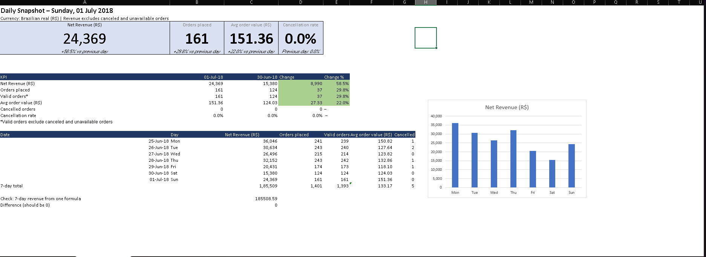
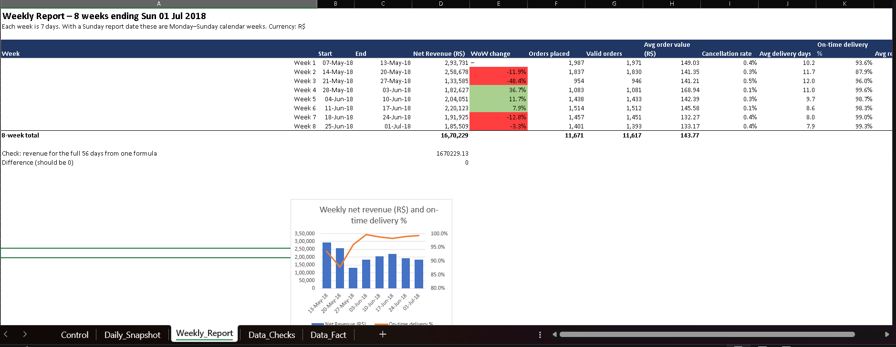

# Automated MIS Reporting System

An automated daily, weekly, and monthly MIS report pack built with Excel
(Power Query, formulas, PivotTables, slicers) and, later, VBA and Power BI.
One control date drives the daily and weekly reports, and every report is
reconciled against the source data.

## Dataset
Olist Brazilian E-Commerce Public Dataset (Kaggle, olistbr), about 100K orders
from 2016 to 2018. The raw data is not stored in this repo. Download it from
Kaggle and place the CSVs in `Data/raw/`. Currency is Brazilian real (R$).

## Status
- [x] Day 1: source tables loaded with Power Query
- [x] Day 2: Fact_Orders built (joins, calculated columns) with reconciliation checks
- [x] Day 3: Control sheet, Daily Snapshot, Weekly Report
- [ ] Day 4: Monthly Report (pivots, charts, slicers)
- [ ] Day 5: Exceptions sheet and Data_Checks
- [ ] Day 6: VBA refresh and PDF export
- [ ] Day 7-8: Power BI version
- [ ] Day 9-10: SQL cross-check, final README, release

## What it does
- Cleans and merges 6 source tables with Power Query into one fact table
  (one row per order item, orders without items kept)
- Daily Snapshot: KPI cards, change vs previous day, and a 7-day table
- Weekly Report: 8 rolling weeks with WoW change, AOV, cancellation rate,
  delivery days, on-time %, and review score
- Every report has a self-check that reconciles it against the source data
- Changing one date cell (Control!B1) updates the daily and weekly reports

## Screenshots
### Daily Snapshot

### Weekly Report

## Findings (report date 01-Jul-2018)
- Weekly revenue peaked in the week of 7-13 May 2018 (R$ 293,731, 1,987 orders).
- Revenue fell 48.4% in the week of 21-27 May 2018 and on-time delivery was lowest
  (87.9%) in the preceding week. Both coincide with the national truckers' strike
  in Brazil that began on 21 May 2018 (the link is not verified).
- On-time delivery recovered to about 98-99% from early June.

## Data checks
- Fact_Orders rows = OrderItems rows + orders with no items
- One flagged row per order (Order Row = 1) equals the Orders row count
- Revenue total in Fact_Orders equals the OrderItems price total
- Daily 7-day and weekly 56-day totals match single-formula checks (difference = 0)

## Design notes
See `docs/data_notes.md` for definitions (Net Revenue, on-time %, valid orders)
and known limitations.

## Tools
Excel (Power Query, SUMIFS/COUNTIFS, PivotTables, slicers), Git

